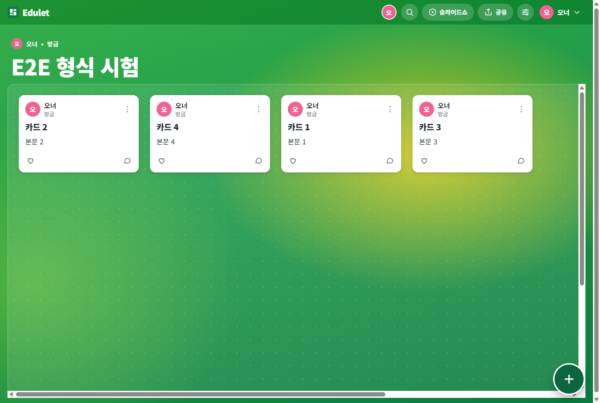

# Edulet

교실·연수에서 쓰는 **실시간 협업 게시판**입니다. 보드 하나를 열어 두고 여럿이 글·이미지·파일·링크를 올리고, 댓글과 반응을 달고, 카드를 끌어 정리합니다. 한 사람이 올린 글은 **새로고침 없이** 모두의 화면에 나타납니다.

- **의존성 0개.** Node 내장 모듈(`http`, `node:sqlite`, `crypto`)만 씁니다. `npm install` 없이 바로 실행됩니다.
- 프런트는 **빌드 없는 ES 모듈**(프레임워크 없음), 실시간은 **SSE**, 저장은 **SQLite 파일 하나**입니다.
- 서버 단위·통합 테스트와, 격리된 크롬 여러 개로 서로 다른 사용자를 흉내 내는 **E2E 수락 시나리오**가 함께 들어 있습니다.

| 줄 형식 (참조 보드 재현) | 상세 보기 |
|---|---|
|  |  |

| 캔버스 | 모바일 |
|---|---|
|  |  |

## 빠른 시작

Node.js **22.13 이상**이 필요합니다.

```bash
npm start            # http://localhost:3000
```

Windows 에서는 `run.cmd` 를 더블클릭해도 됩니다(브라우저가 같이 열립니다). 처음 시작하면 데모 보드 두 개가 만들어집니다.

| 주소 | 내용 |
|---|---|
| `/b/demo-board` | 공개 참조 보드("연수 예시 보드")를 옮긴 **줄 형식** 보드 — 섹션 3개, 카드 17장, 댓글 2개. 읽기·댓글만 가능 |
| `/b/practice` | 누구나 글을 올려 볼 수 있는 **연습장**(벽 형식). 창을 두 개 나란히 열고 실시간 동작을 확인해 보세요 |

회원가입 없이도 보드 주소로 들어가 이름만 입력하면(게스트) 참여할 수 있습니다. 보드를 만들려면 가입·로그인이 필요합니다.

Docker:

```bash
docker build -t edulet .
docker run -p 3000:3000 -v edulet-data:/data edulet
```

## GitHub Pages 데모 모드

**https://dhsy3206.github.io/edulet/** — 서버를 켜지 않고 바로 써 볼 수 있는 정적 데모입니다. GitHub Pages 는 파일만 내려 주고 Node 서버를 돌릴 수 없으므로, 이 빌드에서는 **서비스 워커가 서버 역할**(같은 API 계약, `public/edulet-sw.js` + `public/demo/`)을 하고 데이터는 **방문자 브라우저의 IndexedDB** 에 저장됩니다.

| 되는 것 | 안 되는 것 |
|---|---|
| 가입·보드 만들기·글/댓글/반응·업로드(10MB)·형식 7종·내보내기·복제·참조 보드와 연습장 시드 | **다른 기기·다른 사람과 보드를 공유할 수 없습니다.** 내가 만든 보드와 글은 이 브라우저에만 있습니다(사이트 데이터를 지우면 사라짐) |
| 같은 브라우저의 **여러 탭** 사이 실시간 동기화(BroadcastChannel) | 여러 사람이 동시에 쓰는 실시간 협업 — 서버 모드(`npm start`/Docker)가 필요합니다 |
| 화면 왼쪽 아래 "데모 모드" 알약에서 설명 확인·**초기화**(시드 복원) | 요청 한도·저장 공간 한도·SSRF 검사 같은 서버 쪽 방어(내 브라우저 안에서만 도는 데모라 대상이 아닙니다), 링크 미리보기는 브라우저가 접근할 수 있는 주소만 |

서비스 워커를 쓸 수 없는 브라우저(일부 시크릿 창 등)에서는 한국어 안내가 나옵니다. 배포는 `main` 에 푸시하면 `.github/workflows/pages.yml` 이 `node tools/build-pages.mjs --base /edulet` 으로 `dist/` 를 만들어 올립니다(`npm run build:pages`). 실제 교실에서 여럿이 함께 쓰려면 위 빠른 시작처럼 서버를 띄우세요.

## 기능

| 영역 | 내용 |
|---|---|
| 형식 7종 | 벽 · 격자 · 스트림 · 선반(열) · 줄(행) · 캔버스(자유 배치) · 채팅. 설정에서 바꾸면 모두의 화면이 즉시 바뀝니다 |
| 글 | 제목·본문(굵게/기울임/목록/자동 링크), 이미지·파일 업로드(붙여넣기·끌어놓기), 링크 미리보기, YouTube/Vimeo 임베드, 카드 색, 고정 |
| 정리 | 카드 끌어서 순서 변경·섹션 이동, 섹션 추가·이름 변경·이동·삭제, 캔버스 자유 이동·폭 조절 |
| 상호작용 | 댓글, 반응(좋아요 · 투표 · 별 · 점수 1~10 · 이모지 중 보드마다 하나), 접속자 표시 |
| 보기 | 상세 보기(이전/다음, 키보드), 슬라이드쇼(자동 재생), 검색 |
| 공유·권한 | 링크 공개/비공개, 링크 접속자 권한(보기·댓글·글쓰기·관리), 구성원별 역할, QR 코드, 승인제(글을 올리면 관리자 승인 뒤 공개) |
| 관리 | 배경 10종 + 직접 올린 이미지, 글꼴, 카드 계열(밝음/어두움), 내보내기(JSON·CSV), 보드 복제, 템플릿(KWL·돌아보기·연수 자료) |

권한은 **서버에서 강제**합니다(화면에서 버튼을 숨기는 것에 의존하지 않습니다).

| 역할 | 할 수 있는 일 |
|---|---|
| 보기 | 보드 보기, 내보내기 |
| 댓글 | + 댓글, 반응 |
| 글쓰기 | + 글 올리기, **내 글** 수정·삭제·이동 |
| 관리 | + 남의 글 수정·삭제·이동, 고정, 승인, 섹션 관리 |
| 관리자 | + 보드 설정, 구성원 관리 (보드 삭제는 만든 사람만) |

## 설정(환경변수)

모두 `EDULET_` 접두사입니다.

| 이름 | 기본값 | 설명 |
|---|---|---|
| `PORT` / `HOST` | `3000` / `0.0.0.0` | 접속 주소 |
| `DATA_DIR` | `./data` | DB(`edulet.db`)와 업로드 파일 위치 — **백업은 이 폴더만** |
| `SEED` | `auto` | `auto` = DB 가 비었을 때만 데모 보드 생성, `0` = 끄기, `1` = 항상 |
| `ALLOW_REGISTER` | `1` | `0` 이면 가입 막기(기존 계정·게스트만) |
| `MAX_UPLOAD_MB` | `20` | 업로드 한도 |
| `SESSION_DAYS` | `30` | 로그인 유지 기간 |
| `LINK_PREVIEW` | `1` | `0` 이면 서버가 외부 주소를 가져오지 않음(호스트 이름만 표시) |
| `TRUST_PROXY` | `0` | 리버스 프록시 뒤에서 `1` — `X-Forwarded-*` 를 믿고 접속자 IP·HTTPS 를 판별 |
| `COOKIE_SECURE` | `auto` | HTTPS 로 운영하면 `1` |

남용 방지 한도도 환경변수로 조절합니다(기본값과 뜻은 `docs/CONTRACT.md` §1): `GUEST_RATE`(IP당 게스트 참여/분, 기본 300 — 교실 하나가 공용 IP 를 써도 충분), `WRITE_RATE`(사용자당 쓰기/분), `UPLOAD_RATE` · `UPLOAD_QUOTA_MB` · `UPLOAD_CONCURRENCY` · `UPLOAD_PER_USER`, `SSE_PER_USER` · `SSE_PER_IP` · `MAX_CONNECTIONS`, `BOARD_MAX_POSTS`, `LOGIN_FAIL_MAX`, `MEMBER_RATE`.

> 공개 서버로 운영한다면: HTTPS + `TRUST_PROXY=1` + `COOKIE_SECURE=1`, 프록시에서 SSE 경로(`/api/boards/*/events`)의 응답 버퍼링을 끄세요(nginx: `proxy_buffering off;`). 누구나 쓸 수 있는 연습장이 필요 없으면 `SEED=0` 을 권합니다.

## 구조

```
server/   Node 서버 — http.js(라우터) auth/boards/posts/sections/comments/reactions/uploads/preview(SSRF 방어)/realtime(SSE)/seed
public/   프런트 — js/lib(공용 기반·BoardController) js/views(앱 셸·페이지) js/board(보드 캔버스) css/ vendor/(QR)
          edulet-sw.js · demo/  Pages 데모용 서비스 워커 "서버"(IndexedDB 저장)와 부팅 스크립트
seed/     데모 보드 JSON + 이미지
test/     서버 테스트(node:test)      e2e/  브라우저 수락 시나리오(run.mjs 서버 모드 · pages.mjs 데모 모드)
tools/    cdp.mjs(크롬 구동기) · build-pages.mjs(정적 사이트 빌드) 등
docs/     CONTRACT.md(서버↔프런트 계약) REFERENCE.md(참조 보드 분석)
```

실시간은 보드마다 SSE 연결 하나로 흐릅니다. 클라이언트는 **스트림을 먼저 열고 그다음 스냅샷을 받아** 그 사이의 변경을 놓치지 않으며, 연결이 끊기면 다시 붙을 때 스냅샷을 새로 받습니다. 모든 이벤트는 글 전체 상태를 담아 같은 글에 여러 번 적용해도 결과가 같습니다.

## 테스트

```bash
npm test         # 서버 단위·통합 테스트 (의존성·브라우저 불필요, 약 15초)
npm run e2e      # 실제 크롬 여러 개로 실시간·형식 전환·드래그 이동 등 (Chrome/Edge 필요, CHROME_PATH 로 지정 가능)
npm run e2e:pages  # Pages 데모 빌드를 /edulet/ 아래 정적 서버로 띄워 서비스 워커 부팅·탭 간 동기화·업로드·초기화 등 확인
```

E2E 는 `tools/cdp.mjs`(Node 22 내장 WebSocket 으로 크롬 DevTools 프로토콜을 직접 구동, 의존성 0)로 사용자마다 격리된 브라우저 컨텍스트를 만들어 실제 마우스·키보드 이벤트를 보냅니다.

## 보안 메모

- 비밀번호는 scrypt, 세션 토큰은 서버에 해시만 저장, 쿠키는 HttpOnly·SameSite=Lax. 상태를 바꾸는 요청은 Origin 을 확인합니다.
- 사용자 입력은 항상 텍스트 노드/속성으로만 DOM 에 넣고(`innerHTML` 미사용), 링크는 `http(s)` 만 허용, 영상 임베드는 `youtube-nocookie`/`player.vimeo.com` 만 허용합니다. CSP 가 인라인 스크립트를 막습니다.
- 링크 미리보기는 서버가 외부 주소를 가져오므로 사설·루프백 주소와 리다이렉트를 모두 검사하고(SSRF 방어), 연결 시 검사한 주소로 고정합니다.
- 업로드는 매직 바이트로 이미지를 검증하고(SVG 거부) 이미지가 아닌 파일은 항상 내려받기로만 제공합니다.
- 계약 문서(`docs/CONTRACT.md`)에 권한표·API·이벤트가 정리돼 있습니다.

## 제3자 구성 요소와 출처

- QR 코드: Kazuhiko Arase 의 *QRCode for JavaScript*(MIT) 핵심부를 `public/vendor/qrcode.js` 로 묶어 사용 — 라이선스는 `public/vendor/LICENSE-qrcode.txt`. "QR Code" 는 DENSO WAVE INCORPORATED 의 등록상표입니다.
- 데모 보드 `demo-board` 는 공개된 참조 보드의 구조·문구·첨부를 옮긴 것입니다(작성자 표시 이름과 이미지 포함). 이 저장소와 Pages 데모는 공개 상태라 이 내용도 그대로 공개됩니다 — 원 작성자가 원하지 않거나 쓸 권리가 불확실하면 `seed/demo-board.json` 과 `seed/img/` 를 바꾸거나 지우세요. 분석 과정은 `docs/REFERENCE.md` 에 있습니다.
- Edulet 은 Padlet 의 코드·로고·상표·스톡 이미지를 쓰지 않습니다. 구조와 상호작용만 참고했습니다.

## 라이선스

아직 정하지 않았습니다(저장소 소유자가 선택하기 전까지 모든 권리 보유).

## 알려진 한계

Pages 데모는 위 표처럼 브라우저 한 곳에서만 동작하는 체험판입니다(비밀번호도 서버가 아니라 브라우저 안에서 PBKDF2 로 처리). 서버 모드는 서버 한 대·SQLite 한 파일 기준입니다(수백 명 동시 접속 교실 규모에 맞춤, 여러 서버로 나누려면 SSE 팬아웃을 바꿔야 함). 터치 화면에서는 카드를 끌지 않고 ⋮ 메뉴로 순서를 바꿉니다. 지도·타임라인 형식, 그림·녹음 첨부, 메일 알림, 외부 로그인(OAuth)은 만들지 않았습니다.
